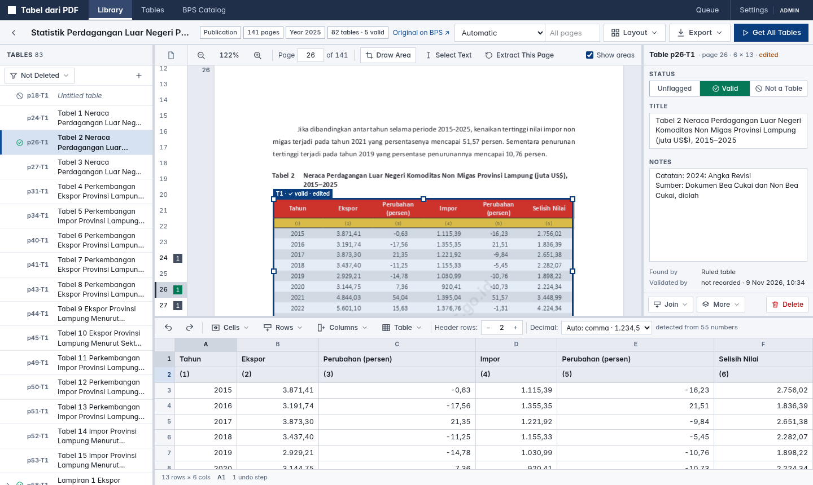
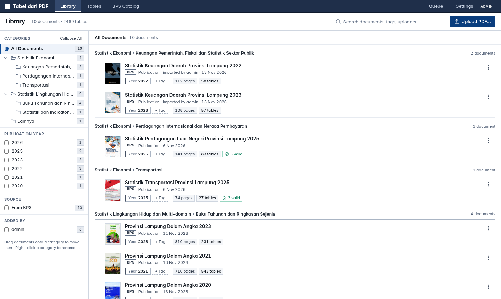
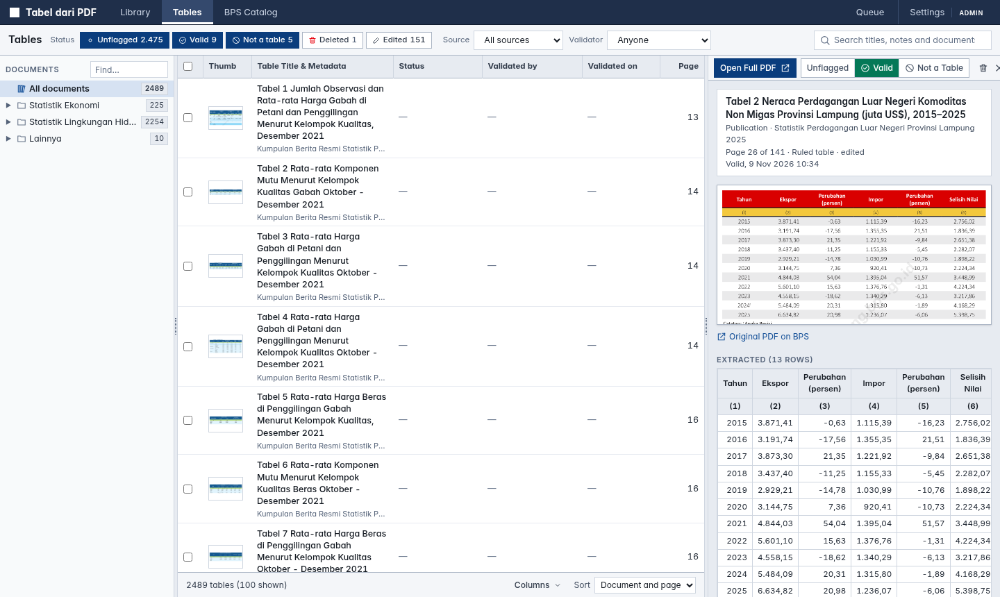
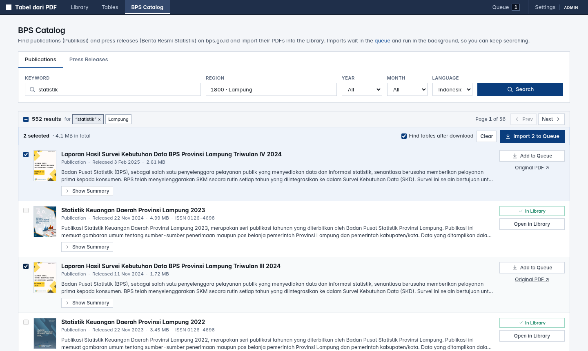
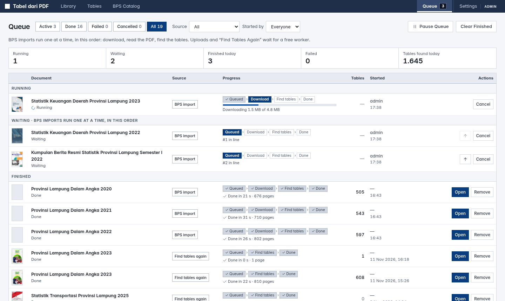
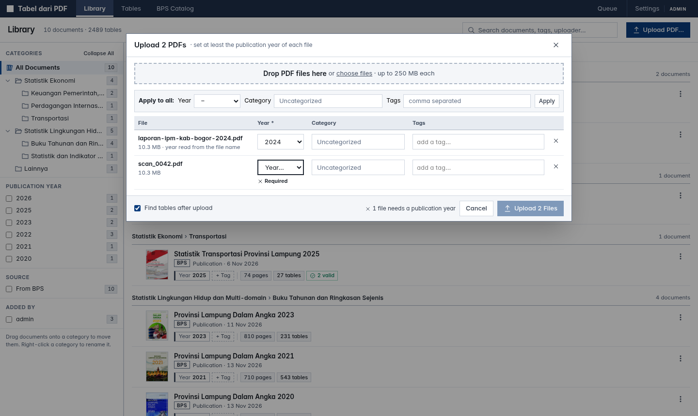
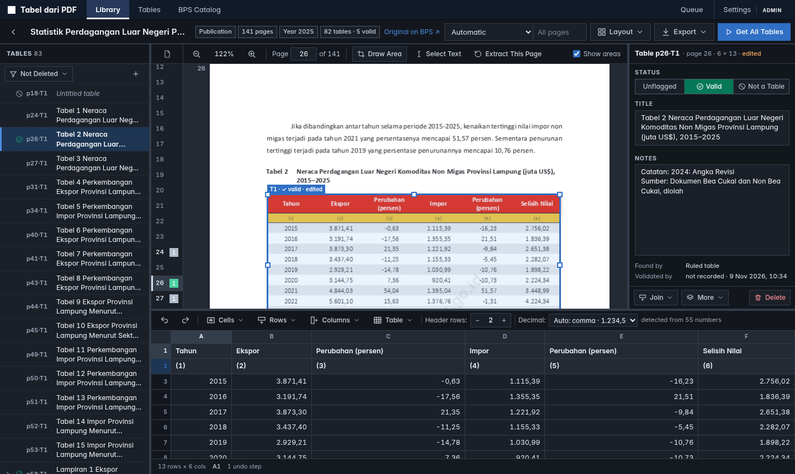
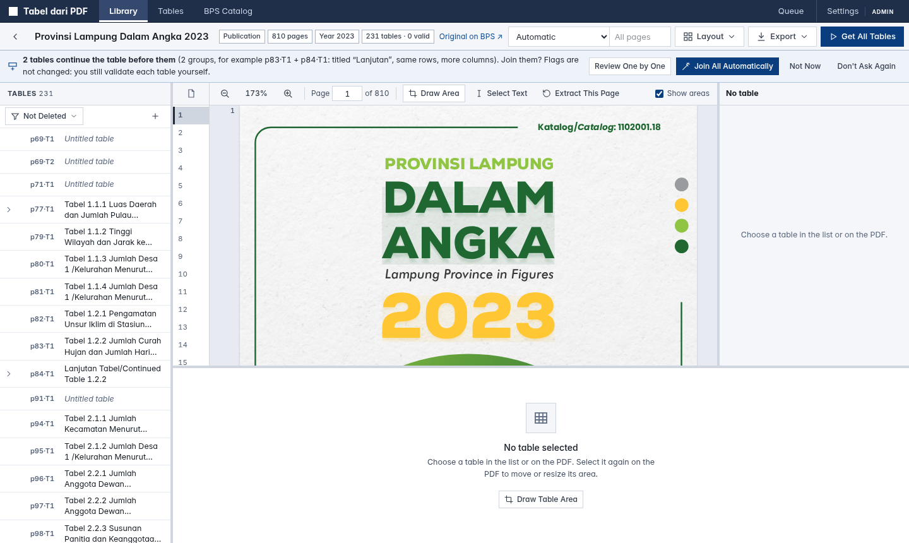
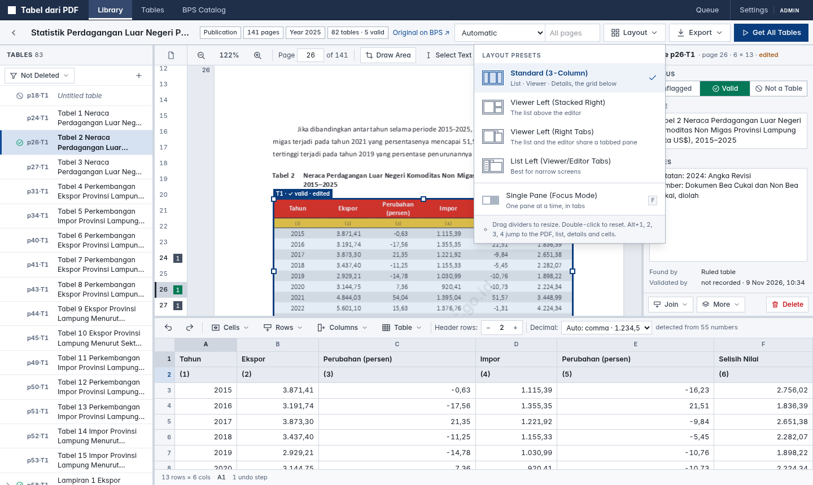

# Tabel dari PDF

Find BPS publications, extract their tables, edit them, export them.
This rewrites `pdf-table-viewer`: **pdfspine** (Apache-2.0, pure Rust) replaces PyMuPDF, and the UI is new.

```
1. get a PDF   upload it (with its publication year and tags), or pick publications / press releases
               in the BPS catalog (BPS Web API) and import them through the queue
2. extract     tables are found after an upload or import, or with "Get All Tables" (all pages or a range),
               or draw an area around one table
3. review      join tables that continue on the next page, fix cells, flag each table Valid or Not a table
4. use tables  export to XLSX / CSV / JSON, or read the valid ones through the public JSON API
```



| | |
|---|---|
|  **Library**: documents by category, year, tags, who added them |  **Tables**: every table, who validated it, preview next to the PDF |
|  **BPS Catalog**: select several results, import them to the queue |  **Queue**: imports run one at a time; move, cancel, retry, pause |
|  **Upload**: each file needs a publication year |  **Dark scheme**: follows the system, or Settings → Appearance |

## Stack

| part      | tech |
|-----------|------|
| backend   | FastAPI, SQLite (`data/library.db`), thread-pool jobs, `pdfspine` for parsing, text, tables and thumbnails |
| frontend  | Astro (static) + Tailwind v4 (square corners only), vanilla TS, pdf.js (legacy build) |
| BPS       | `webapi.bps.go.id/v1/api`, key read from `.env` (`WEBAPI_BPS_KEY`), never sent to the browser |

## Run

```bash
cp .env.example .env          # add WEBAPI_BPS_KEY
mise install                  # bun, python 3.12, uv
mise run install              # uv sync + bun install
mise run dev                  # API :14433 + UI :4321  -> http://localhost:4321
# production: one process serving API + built UI
mise run start                # -> http://localhost:14433
```

Without mise: `cd backend && uv run uvicorn app.main:app --port 14433 --reload` and `cd frontend && bunx astro dev`.

### Docker

```bash
cp .env.example .env          # add WEBAPI_BPS_KEY (read by docker compose)
docker compose up -d --build  # -> http://localhost:14433   (PORT=8080 docker compose up -d to change the port)
```
One image (`Dockerfile`: Astro build stage + Python 3.12 slim, ~370 MB) serving API and UI, running as uid 1000.
The library lives in the volume `tabel-data` mounted at `/data`; see `docker-compose.yml` to use a host folder instead.

### Backup, restore, moving the library

Everything (database: documents, tables, edits, flags, categories, history; plus the PDFs) goes into one `.zip`:

- In the app: **Settings → Backup and Restore** (download with or without PDFs; restore by *adding* to the library or
  *replacing* it; a replace first moves the current library to `data/backups/before-restore-<time>/`).
- API: `GET /api/backup?pdfs=true|false`, `POST /api/backup/restore` (multipart `file`, `mode=merge|replace`), `GET /api/backup/info`.
- CLI: `cd backend && uv run python -m app.backup export [out.zip] [--no-pdfs]` / `... import file.zip --mode merge|replace`;
  in Docker `docker compose exec app python -m app.backup export` (written to `/data/backups/`, copy it out with `docker compose cp`).

A non-Docker library moves into Docker (and back) with a backup + restore. `library.db` is plain SQLite, so it can also
be opened directly (e.g. `sqlite3 data/library.db`); table cells are JSON in `tables.rows`. For the tables themselves
as spreadsheets use the Excel / CSV / JSON exports.

## Extraction engines (`backend/app/extract/`)

| id       | how |
|----------|-----|
| `auto`   | ruled tables from `lines`; a ruled frame around an open body is re-split with `stream`; then `stream` for the remaining borderless tables |
| `lines`  | `page.find_tables(strategy="lines")` for the grid; cell text from our own word index |
| `stream` | borderless tables: words → lines → column bands from numeric rows, with header/caption/footer detection |
| `text`   | pdfspine's built-in `text` strategy, unmodified, for comparison |
| `tatr`   | Table Transformer via pdfspine (`strategy="vision", backend="tatr"`), **not enabled yet** |

The word index (`words.py`) fixes two problems in BPS PDFs:

- **fake-bold shadow glyphs**, which would otherwise read "6.342" as "66..334422";
- **rotated watermarks**, which are dropped.

Accuracy, measured against the old project's hand-checked ground truth (4 PDFs, 164 pages, 351 rows):

```
                       auto     lines   stream
row exact              94.0%    35.3%   83.8%
values in own cell    100.0%    44.5%   95.9%
false-pos tables (pages)  2        0        2
total time            ~1.8 s   ~1.6 s   ~1.2 s
```

(The old `auto` with torch-based TATR scored 98.6% and took 54 s.) Of the rows `auto` misses, 19 are in a text-only schedule table with no numbers, which is the kind of table TATR should handle.

```bash
mise run score -- --gt ../../pdf-table-viewer/groundtruth ../../pdf-table-viewer/*.pdf --verbose
```

### Enabling Table Transformer later

```bash
cd backend && uv add "pdfspine[tatr]"     # torch + transformers
```

The engine then appears automatically in the UI. Pre-fetching the two pinned models is described in pdfspine's tables docs.

## Reviewing tables

**Workspace** (`/doc?id=…&table=…`)

- Each table has a **title** (from the caption: "Tabel 2.1 …", "Lampiran 1.7 …") and **notes** (the "Sumber : …", "Catatan: …" and footnote lines under it). Both are filled in automatically and can be edited.
- Click a box to select it. **Drag** the selected box to move it, or pull its **handles** to resize it. The region is then extracted again.
  If you already edited the table, you're asked first. The previous version stays in history either way.
- Flag a region as **Valid table** (`v`) or **Not a table** (`x`).
- **Delete** is a soft delete: the table can be restored, or deleted permanently.
- Editor:
  - Edit cells.
  - Select cells by dragging, shift-clicking, or clicking row/column headers.
  - **Merge** and **Unmerge** cells.
  - Insert or delete rows and columns.
  - Join wrapped rows.
  - Set the number of header rows.
- Changing cells, merges, rows or columns sets the **edited** flag. **Undo/Redo** also steps back through versions saved in SQLite, so it works after a reload. **Reset** goes back to the extracted version.
- Re-running extraction never overwrites tables that are edited, flagged, deleted or drawn by hand.
- **Join** tables that continue across pages. When the next table repeats the header, a banner suggests the join ("Join p44·T1").
  - The **Join** menu appends any of the next tables, or appends this table to the previous one.
  - When joining, header rows that repeat the first table's header are dropped.
  - Tables split across pages by **width** (same row labels, e.g. columns (1)–(3) on one page and (1), (4), (5) on the next) are joined **as columns**: rows are matched on the first (label) column, and the repeated label column is dropped. This is detected automatically; the Join menu also offers "Join Below" and "Join as Columns" to choose explicitly.
  - The joined table keeps a link to every page region; each continuation is drawn as a dashed "part" box.
  - **Unjoin** puts both tables back.
  

  - When a document is opened (and after *Get All Tables*) and it has continuations that are not joined yet, a bar
    offers to join them: **Join All Automatically**, or **Review One by One** (each group is shown in the PDF and the
    editor: Join, Skip, Join All Remaining, Stop). *Not Now* asks again next time; *Don't Ask Again* stays quiet for
    this document until new continuations are found. Joining never sets a flag: validating stays manual.
  - A continuation is the next table (same or next page) titled "Lanjutan / Continued", with the same table number,
    or repeating the header; with the same row labels and more columns it is joined as columns. Two tables with
    **different** numbers ("Tabel 2" and "Tabel 3") are never suggested, even when their headers are the same.
  - Exports label a joined table with its page range ("halaman 43–44").

- In a joined table, the editor marks where each page's rows begin (a `p69` tag and a divider line).
  - A join uses the cells as they are now, edits included (unsaved edits are saved first).
  - Clicking a part (`p69`) in the list, or its dashed box on the PDF, scrolls the editor to that page's rows and selects them.
  - The status bar shows which page the current row came from.
  - Right-click a cell and choose **Show page N in PDF** to jump to that page's region.
- The workspace has four panes: the **table list**, the **PDF** with a page rail (page numbers and the number of
  tables on each page; green = one of them is valid), the **details** of the open table (flag, title, notes, who
  validated it and when) and the **cells** below.
- **Decimal** (cells toolbar): *Auto* shows what it detected and why ("Auto: comma · 1.234,5 · detected from 55
  numbers"); orange "not sure" means only ambiguous numbers like 1.234 were found, so choose Comma or Dot.
  

- **Layout** (next to *Export*) offers four presets: *Standard (3-Column)*, *Viewer Left (Stacked Right)*,
  *Viewer Left (Right Tabs)*, *List Left (Viewer/Editor Tabs)*, plus *Single Pane (Focus Mode)* (`F`).
  - Drag a divider to resize it; double-click a divider to reset.
  - Double-click a table in the list to bring the editor tab forward.
  - The chosen layout, pane sizes and active tabs are remembered.

**Tables** (`/tables`) lists every table in the library in three resizable panes: documents by category, a dense
table list, and a preview (the PDF region and the extracted cells, with **Open Full PDF**).

- Filter by flag (chips: unflagged / valid / not a table / deleted, plus *edited*), by source, by **validator** and by
  document or category. Search titles, notes and document names.
- Columns: thumbnail, title and document, status, **validated by** and **validated on** (who set the flag valid /
  not a table, and when; cleared when the flag is cleared), page. Sort by document, recent change or validation.
- Select several tables with the checkboxes, Shift+click (a range) or Ctrl+click (one more); Shift+↑↓ and Space work too.
- **Columns** (bottom bar, or right-click the column headers) shows or hides thumbnail, status, validated by / on and page.
- Right-click a category in the document tree (here and in the Library) to expand or collapse it, it and all below it,
  or everything.
- Bulk actions: flag, delete, restore, and export the selection to XLSX / CSV-zip / JSON.

**Library** (`/`): one row per document with who uploaded or imported it, its **publication year** and **tags**, and
filters for category, year (also *Year missing*), source, who added it and tags. Uploading opens a modal where each file
needs a publication year (read from the file name when it has one) and can get a category and tags. *Edit Details and
Tags…* in the ⋮ menu changes title, year, category and tags.

**BPS Catalog** (`/import-from-bps`; the old `/search` links redirect there): select several results and *Import to Queue*; the page stays where it is and each result
shows its place in the queue, its download progress, or *In Library*. The selection is kept across new searches and
result pages, and leaving the page and coming back brings back the last search (per browser tab).

**Queue** (`/queue`): BPS imports run one at a time, in order (download → read the PDF → find tables). Waiting imports
can be moved up or cancelled, failed ones retried; *Pause Queue* lets the running import finish and holds the rest.
Uploads and *Find Tables Again* appear here too. The queue is stored in SQLite and survives a restart (an interrupted
download starts again).

Exports include the title, the notes (under the table in XLSX) and merged cells (real merged ranges in XLSX, a `merges` list in JSON). Document exports skip deleted tables and "not a table" by default; you can also choose *valid only*.

## Design

The UI follows the [KDE Human Interface Guidelines](https://develop.kde.org/hig/) with square corners. See
[DESIGN.md](DESIGN.md) for colors, components, feedback (undo, errors, progress), wording, keyboard shortcuts, layout
and the accessibility check (`mise run check:a11y`).

## Login and access

| who | can |
|-----|-----|
| visitor (not logged in) | read tables **flagged valid** (Library, Tables, the workspace read-only), export them, `/api/v1` |
| `editor` | everything with the library: import (BPS catalog, queue), upload, extract, edit, flag, delete, categories; year and tags of **uploaded** documents |
| `admin` | also year and tags of every document, users (`/users`), backup / restore, permanent deletes |

Two ways to log in (`backend/app/auth.py`):

- **user name + password**: the first admin is created at startup from `ADMIN_USER` / `ADMIN_PASSWORD` in `.env`
  (only when that user does not exist yet; later changes go through the app or the CLI below);
- **Google**: set `GOOGLE_CLIENT_ID`, `GOOGLE_CLIENT_SECRET` and `PUBLIC_URL`. Only e-mail addresses an admin has added
  under Users can log in; anyone else gets "no access". In the Google Cloud console (OAuth client, type *Web application*)
  add the redirect URI `<PUBLIC_URL>/api/auth/google/callback`, e.g.
  `https://tabel-dari-pdf.statapps.dev/api/auth/google/callback`.

A user can have both (a user name with a password, and a Google e-mail). Users and sessions live in `data/auth.db`,
separate from `library.db`: a backup never contains password hashes and a restore never removes accounts. Sessions are an
`HttpOnly; SameSite=Lax` cookie (`Secure` over https), valid `SESSION_DAYS` (7) after the last visit. Every `/api`
route needs an editor unless it is on the public list in `auth.py` (deny by default); writes from other sites are refused
(CSRF); visitors are rate-limited per IP (`RATE_PUBLIC`, `RATE_PUBLIC_FILES` per minute), failed logins 5 per minute.

Behind a reverse proxy, uvicorn must trust its `X-Forwarded-For` / `X-Forwarded-Proto` only from that proxy
(`--forwarded-allow-ips=<proxy IP>`), otherwise visitors can fake their IP (rate limit) and https (Secure cookie).

```bash
cd backend && uv run python -m app.auth create-admin NAME     # Docker: docker compose exec app python -m app.auth ...
uv run python -m app.auth set-password NAME                   # forgotten password (also logs the user out)
uv run python -m app.auth list
```

### Several people at once

- **One extraction job per document**: starting a second one (or extracting a whole page) while a job runs gives `409`
  with the running job, and the UI follows that job ("started by …"). Each user may start `JOBS_PER_USER` (2) table
  searches by hand (Get All Tables, Find Tables Again) at once; searches after an upload and BPS imports are not limited,
  they wait in the queue. The server runs `JOB_WORKERS` (2) searches at the same time, the rest wait in line.
- **Year and tags**: editors set them on uploaded documents; on documents from BPS only an admin can change them.
- **Queue page and the BPS catalog**: editors and admins only (visitors are sent to the login page).
- **No silent overwrites**: the editor sends `base` (the `updated_at` its copy is based on) with every save; when someone
  else saved the table meanwhile the save is refused (`409`, with the current table) and the editor asks: keep my change
  (only the fields I changed are written) or use their version. Saves of one table are sent one after another.
- Writes take the SQLite write lock at their start (`BEGIN IMMEDIATE`), so a second writer waits instead of failing,
  and read-compare-write steps (version check, join, re-extract) cannot interleave.
- **Who did what**: `created_by` / `updated_by` on documents and tables, `created_by` on jobs and history versions
  (user ids from `auth.db`; the API adds `*_by_name` for logged-in users, visitors never see them).
- The same PDF uploaded twice at the same moment, or the same BPS item imported twice, becomes one document.

### Public JSON API (`/api/v1`, no login, CORS open, only tables flagged valid)

```
GET /api/v1/documents?q=&offset=&limit=           documents with valid tables
GET /api/v1/documents/{id}/tables?decimal=        all valid tables of a document, with columns, rows and records
GET /api/v1/tables?q=&document=&offset=&limit=    valid tables (no cells): id, title, page, columns, row_count, url
GET /api/v1/tables/{id}?decimal=auto|,|.          one table: columns, rows, records (numbers parsed), merges, document
```
Responses have an `ETag` (send `If-None-Match` for a 304) and `Cache-Control: max-age=60`.

## API (short)

```
GET  /api/bps/search?kind=publication|pressrelease&domain=0000&keyword=&year=&month=&page=&lang=
GET  /api/bps/domains
GET  /api/locate[?lat=&lon=]    {domain,region,country,source}: the user's BPS province (browser coordinates via OSM Nominatim, else ip-api.com)
POST /api/bps/import            {kind,id,domain,lang,extract}    (adds one item to the queue)
GET  /api/queue?status=active|done|error|cancelled|all&source=&by=     GET /api/queue/count
POST /api/queue/imports {items:[{kind,id,domain,lang,extract,title?}]}   POST /api/queue/imports/{id}/cancel|retry|move {to:up|top}
DELETE /api/queue/imports/{id}  POST /api/queue/jobs/{id}/retry  DELETE /api/queue/jobs/{id}  POST /api/queue/pause {paused}  POST /api/queue/clear
GET  /api/documents             POST /api/documents (multipart file, extract, year, tags=[json], category=[json])
GET  /api/documents/{id}        PATCH {title?,category?,year?,tags?}  DELETE ...   /pdf   /thumb
POST /api/documents/move        {ids,category}        POST /api/documents/{id}/auto-category
POST /api/categories/rename     {path,to}             (rename / move a category with everything below it; to=[] = uncategorise)
POST /api/documents/{id}/jobs   {engine,pages?,replace}     GET /api/jobs/{id}   POST /api/jobs/{id}/cancel
POST /api/documents/{id}/extract {page,bbox?,engine}        (region, bbox in PDF points)
GET  /api/documents/{id}/tables POST (empty table)
GET  /api/tables?state=valid,none,invalid,deleted&edited=&docs=&kinds=&validator=&q=&sort=document|recent|validated&offset=&limit=   (+ facet counts)
GET  /api/tables/{id}           (with document reference)
PATCH /api/tables/{id} {title,notes,rows,merges,header_rows,status,deleted,bbox,checkpoint}
POST /api/tables/{id}/reextract {bbox?,engine}   POST /api/tables/{id}/reset
GET  /api/tables/{id}/versions  POST /api/tables/{id}/versions/{vid}/restore
DELETE /api/tables/{id}[?purge=true]             POST /api/tables/bulk {ids,action: valid|invalid|none|delete|restore|purge}
GET  /api/tables/{id}/snapshot.png               (PDF region, rendered by pdfspine)
GET  /api/tables/{id}/export?format=csv|xlsx|json
GET  /api/tables-export?ids=a,b&format=xlsx|zip|json
GET  /api/documents/{id}/export?format=xlsx|zip|json&include=usable|valid|all&decimal=auto|,|.&title=false
GET  /api/auth/me    POST /api/auth/login {username,password}    POST /api/auth/logout    POST /api/auth/password {current,new}
GET  /api/auth/google/start?next=/path    GET /api/auth/google/callback
GET  /api/users      POST /api/users {username?,email?,name,role,password?}    PATCH|DELETE /api/users/{id}   (admin)
```
**Categories.** Documents carry a category path of any depth (`["Statistik Ekonomi", "Transportasi"]`, `[]` = Uncategorized),
shown as a tree in the Library. BPS imports are filed automatically under the BPS subject classification (CSA: subject
category / subject, `backend/app/categories.py`); when BPS gives no subject (common for regional publications) the title is
matched against keywords, otherwise `Lainnya`. Uploads start in Uncategorized (or the category open in the Library).

XLSX export: the first sheet is `Index` (one row per table, linked to its sheet: title, document, category, page, flag, …),
then one sheet per table named `s001`, `s002`, … holding only the table (from A1, header rows bold, numbers as numbers).
`title=true` also writes the table title above it and the notes below.
The decimal separator is chosen per table: `decimal=,` / `decimal=.` forces it for every table; `auto` (default) uses the
table's own setting (`PATCH {decimal_sep: "auto"|","|"."}`, the "Decimal" control in the editor), and when that is `auto`
it is detected from the body cells: `10.498,2`, `1.234.567`, `25,9` vote strongly, ambiguous `1.234` only breaks ties,
and with no evidence the Indonesian `,` is kept.

**Local settings** (`/settings`, `frontend/src/lib/settings.ts`) live in the browser's localStorage only: color scheme
(same as the system, light or dark), default BPS region (detected from the browser location, else the internet address;
or a fixed region), remembering the last search filters (never the keyword), result language, finding tables after
upload, and export defaults. The BPS catalog also keeps the current search and selection for the browser tab
(sessionStorage), so leaving the page and coming back restores them.

## Contributing

Notes for people and coding agents (layout of the code, testing on a copy of the library, conventions) are in
[`frontend/AGENTS.md`](frontend/AGENTS.md). Screenshots for this README live in `docs/screenshots/`.
